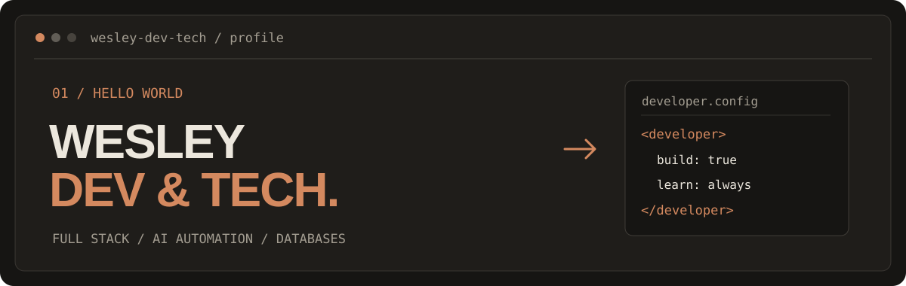
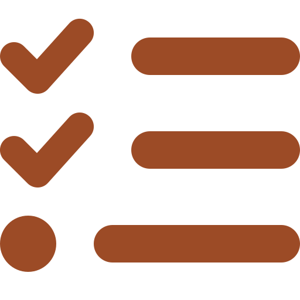
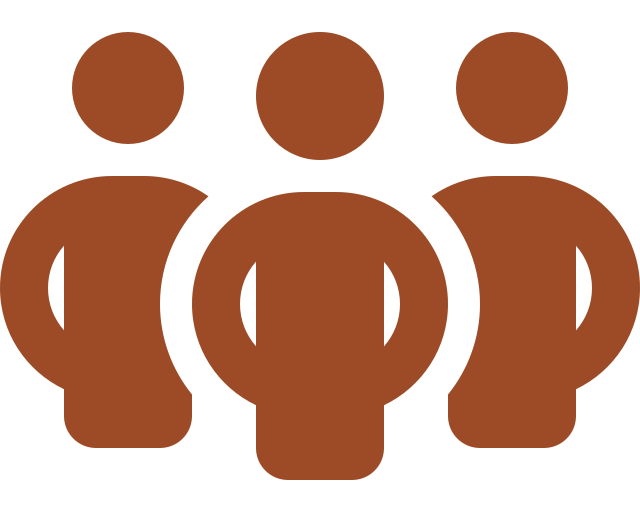
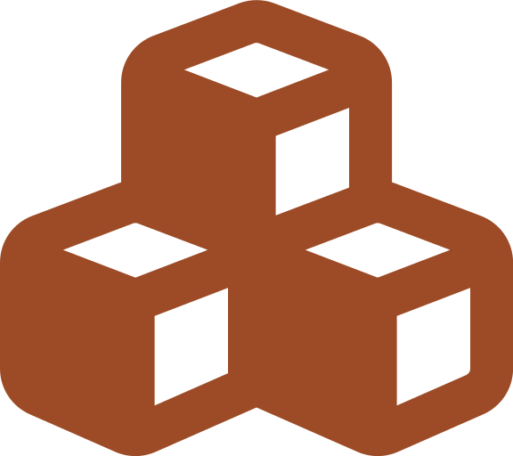

  <picture>
    <source media="(prefers-color-scheme: light)" srcset="https://raw.githubusercontent.com/Wesley-dev-tech/Wesley-dev-tech/09f5aa4f2e457b8fe63e478ac8e687f1dee453c6/assets/header-light.svg">
    
  </picture>

  <picture>
    <source media="(prefers-color-scheme: light)" srcset="https://raw.githubusercontent.com/Wesley-dev-tech/Wesley-dev-tech/2d8a95f83dce895f279ff9cd7054921b240907d6/assets/divider-light.svg">
    
  </picture>

 <strong><em>I hear and I forget. I see and I remember. I do and I understand.</em></strong>  <em>Learn by building. Test what works. Improve what doesn’t.</em>

  <picture>
    <source media="(prefers-color-scheme: light)" srcset="https://raw.githubusercontent.com/Wesley-dev-tech/Wesley-dev-tech/2d8a95f83dce895f279ff9cd7054921b240907d6/assets/divider-light.svg">
    
  </picture>

###  Hi there, I'm Wesley.

🎓 I'm following the full-time **Full Stack & AI Automation Developer** course at SyntraPXL. After several years in accounting and administration, I swapped spreadsheets for stylesheets — and kept my appreciation for clean data. Now I'm learning to build websites, web applications and software tailored to real needs.

🧩 Curiosity took me from clicking buttons to wondering what happens behind them. I enjoy breaking problems into smaller steps, testing ideas and debugging the parts that have other plans. My finance background taught me to think carefully about data and processes; now I'm putting that mindset to work in code, one commit at a time.

📍 Balen, Belgium 🇧🇪

  <picture>
    <source media="(prefers-color-scheme: light)" srcset="https://raw.githubusercontent.com/Wesley-dev-tech/Wesley-dev-tech/2d8a95f83dce895f279ff9cd7054921b240907d6/assets/divider-light.svg">
    
  </picture>

## ⚙️ What I'm focused on

- 🎨 **Frontend** — building clear, responsive interfaces with HTML, CSS and JavaScript, and stepping up to React, Angular and Tailwind. “It works on my screen” isn't the finish line.

##

- 🗄️ **Backend** — creating APIs with Node.js, Express and Laravel, while giving MySQL and Supabase tables, queries and relationships the structure they deserve. The part nobody sees, but everybody notices when it breaks.

##

- 🛠️ **Tools** — using Git, GitHub Actions and testing with Vitest and Jest to ship with confidence. If it isn't tested, it's just a theory.

##

- 🧭 **Concepts & ways of working** — planning in sprints, splitting problems into small steps and keeping data and processes tidy, a habit from my finance years. Good software starts before the first line of code.

##

- 🤖 **AI automation** — exploring practical ways to connect tools and reduce repetitive work. Fewer copy-paste marathons, more time to solve the actual problem.

  <picture>
    <source media="(prefers-color-scheme: light)" srcset="https://raw.githubusercontent.com/Wesley-dev-tech/Wesley-dev-tech/2d8a95f83dce895f279ff9cd7054921b240907d6/assets/divider-light.svg">
    
  </picture>

## 💻 My Tech Stack

### Frontend

  &nbsp;&nbsp;
  &nbsp;&nbsp;
  &nbsp;&nbsp;
  &nbsp;&nbsp;
  <picture><source media="(prefers-color-scheme: light)" srcset="https://raw.githubusercontent.com/tandpfun/skill-icons/7f7e691e71aec64e8354bf697835e009d1ad80f8/icons/React-Light.svg"></picture>&nbsp;&nbsp;
  <picture><source media="(prefers-color-scheme: light)" srcset="https://raw.githubusercontent.com/tandpfun/skill-icons/7f7e691e71aec64e8354bf697835e009d1ad80f8/icons/Angular-Light.svg"></picture>&nbsp;&nbsp;
  <picture><source media="(prefers-color-scheme: light)" srcset="https://raw.githubusercontent.com/tandpfun/skill-icons/7f7e691e71aec64e8354bf697835e009d1ad80f8/icons/Vite-Light.svg"></picture>&nbsp;&nbsp;
  &nbsp;&nbsp;
  <picture><source media="(prefers-color-scheme: light)" srcset="https://raw.githubusercontent.com/tandpfun/skill-icons/7f7e691e71aec64e8354bf697835e009d1ad80f8/icons/TailwindCSS-Light.svg"></picture>&nbsp;&nbsp;
  <picture><source media="(prefers-color-scheme: light)" srcset="https://raw.githubusercontent.com/tandpfun/skill-icons/7f7e691e71aec64e8354bf697835e009d1ad80f8/icons/NextJS-Light.svg"></picture>&nbsp;&nbsp;
  <picture><source media="(prefers-color-scheme: light)" srcset="https://raw.githubusercontent.com/tandpfun/skill-icons/7f7e691e71aec64e8354bf697835e009d1ad80f8/icons/Vercel-Light.svg"></picture>&nbsp;&nbsp;
  <picture><source media="(prefers-color-scheme: light)" srcset="https://raw.githubusercontent.com/tandpfun/skill-icons/7f7e691e71aec64e8354bf697835e009d1ad80f8/icons/Netlify-Light.svg"></picture>&nbsp;&nbsp;
  <picture><source media="(prefers-color-scheme: light)" srcset="./assets/skills/tile-apachecordova-light.svg"></picture>&nbsp;&nbsp;

### Backend

  <picture><source media="(prefers-color-scheme: light)" srcset="https://raw.githubusercontent.com/tandpfun/skill-icons/7f7e691e71aec64e8354bf697835e009d1ad80f8/icons/NodeJS-Light.svg"></picture>&nbsp;&nbsp;
  <picture><source media="(prefers-color-scheme: light)" srcset="https://raw.githubusercontent.com/tandpfun/skill-icons/7f7e691e71aec64e8354bf697835e009d1ad80f8/icons/ExpressJS-Light.svg"></picture>&nbsp;&nbsp;
  <picture><source media="(prefers-color-scheme: light)" srcset="https://raw.githubusercontent.com/tandpfun/skill-icons/7f7e691e71aec64e8354bf697835e009d1ad80f8/icons/PHP-Light.svg"></picture>&nbsp;&nbsp;
  <picture><source media="(prefers-color-scheme: light)" srcset="https://raw.githubusercontent.com/tandpfun/skill-icons/7f7e691e71aec64e8354bf697835e009d1ad80f8/icons/Laravel-Light.svg"></picture>&nbsp;&nbsp;
  <picture><source media="(prefers-color-scheme: light)" srcset="./assets/skills/tile-hono-light.svg"></picture>&nbsp;&nbsp;
  <picture><source media="(prefers-color-scheme: light)" srcset="./assets/skills/tile-fastify-light.svg"></picture>&nbsp;&nbsp;
  <picture><source media="(prefers-color-scheme: light)" srcset="https://raw.githubusercontent.com/tandpfun/skill-icons/7f7e691e71aec64e8354bf697835e009d1ad80f8/icons/Python-Light.svg"></picture>&nbsp;&nbsp;
  <picture><source media="(prefers-color-scheme: light)" srcset="https://raw.githubusercontent.com/tandpfun/skill-icons/7f7e691e71aec64e8354bf697835e009d1ad80f8/icons/MySQL-Light.svg"></picture>&nbsp;&nbsp;
  <picture><source media="(prefers-color-scheme: light)" srcset="https://raw.githubusercontent.com/tandpfun/skill-icons/7f7e691e71aec64e8354bf697835e009d1ad80f8/icons/Supabase-Light.svg"></picture>&nbsp;&nbsp;

### Tools & Development

  &nbsp;&nbsp;
  <picture><source media="(prefers-color-scheme: light)" srcset="https://raw.githubusercontent.com/tandpfun/skill-icons/7f7e691e71aec64e8354bf697835e009d1ad80f8/icons/Github-Light.svg"></picture>&nbsp;&nbsp;
  <picture><source media="(prefers-color-scheme: light)" srcset="https://raw.githubusercontent.com/tandpfun/skill-icons/7f7e691e71aec64e8354bf697835e009d1ad80f8/icons/GithubActions-Light.svg"></picture>&nbsp;&nbsp;
  <picture><source media="(prefers-color-scheme: light)" srcset="./assets/skills/tile-githubcopilot-light.svg"></picture>&nbsp;&nbsp;
  <picture><source media="(prefers-color-scheme: light)" srcset="https://raw.githubusercontent.com/tandpfun/skill-icons/7f7e691e71aec64e8354bf697835e009d1ad80f8/icons/Jenkins-Light.svg"></picture>&nbsp;&nbsp;
  <picture><source media="(prefers-color-scheme: light)" srcset="https://raw.githubusercontent.com/tandpfun/skill-icons/7f7e691e71aec64e8354bf697835e009d1ad80f8/icons/Linux-Light.svg"></picture>&nbsp;&nbsp;
  <picture><source media="(prefers-color-scheme: light)" srcset="./assets/skills/tile-jira-light.svg"></picture>&nbsp;&nbsp;
  <picture><source media="(prefers-color-scheme: light)" srcset="./assets/skills/tile-trello-light.svg"></picture>&nbsp;&nbsp;
  <picture><source media="(prefers-color-scheme: light)" srcset="./assets/skills/tile-clickup-light.svg"></picture>&nbsp;&nbsp;
  <picture><source media="(prefers-color-scheme: light)" srcset="https://raw.githubusercontent.com/tandpfun/skill-icons/7f7e691e71aec64e8354bf697835e009d1ad80f8/icons/Notion-Light.svg"></picture>&nbsp;&nbsp;
  <picture><source media="(prefers-color-scheme: light)" srcset="./assets/skills/tile-cursor-light.svg"></picture>&nbsp;&nbsp;
  <picture><source media="(prefers-color-scheme: light)" srcset="./assets/skills/tile-openai-light.svg"></picture>&nbsp;&nbsp;
  <picture><source media="(prefers-color-scheme: light)" srcset="https://raw.githubusercontent.com/tandpfun/skill-icons/7f7e691e71aec64e8354bf697835e009d1ad80f8/icons/Vitest-Light.svg"></picture>&nbsp;&nbsp;
  &nbsp;&nbsp;
  <picture><source media="(prefers-color-scheme: light)" srcset="./assets/skills/tile-insomnia-light.svg"></picture>&nbsp;&nbsp;

### Concepts & Methodologies

<picture><source media="(prefers-color-scheme: dark)" srcset="./assets/skills/fa-list-check-dark.svg"></picture> <strong>Monday</strong> — this is where I plan my tasks, track how far a project has come and coordinate the work when we work as a team.

<picture><source media="(prefers-color-scheme: dark)" srcset="./assets/skills/fa-people-group-dark.svg"></picture> <strong>Scrum</strong> — in class I work in sprints: we estimate tasks with planning poker, track them on a Kanban board in Trello and discuss what could be better after every sprint.

<picture><source media="(prefers-color-scheme: dark)" srcset="./assets/skills/fa-plug-dark.svg"></picture> <strong>REST API</strong> — with JavaScript I request data through HTTP requests and show the API's response on my page.

<picture><source media="(prefers-color-scheme: dark)" srcset="./assets/skills/fa-cubes-dark.svg"></picture> <strong>MCP</strong> — I use it to connect AI assistants to my own tools, such as GitHub and Google Drive, so they can work directly with my files and data.

  <picture>
    <source media="(prefers-color-scheme: light)" srcset="https://raw.githubusercontent.com/Wesley-dev-tech/Wesley-dev-tech/2d8a95f83dce895f279ff9cd7054921b240907d6/assets/divider-light.svg">
    
  </picture>

## 📬 Let's connect

🤝 Finance taught me to keep data tidy. Full-stack training taught me that a missing bracket can hide in plain sight. 🐛 I'm looking for a team to learn from and build useful software with.

Curious what I've built so far? Explore my portfolio or say hi on WhatsApp. I'm always up for a chat about code, good ideas, and the occasional `works on my machine` mystery. ☕

 

  
  
  

