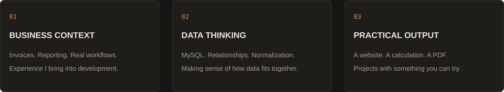
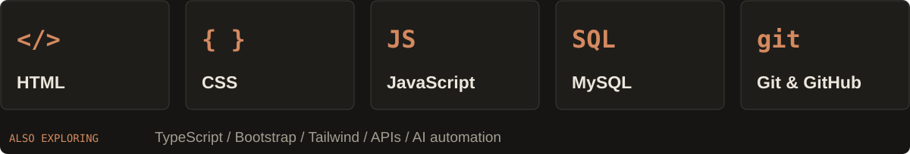

<!-- Original profile design for Wesley Dev & Tech. SVG artwork lives in /assets. -->
<p align="center">
  <picture>
    <source media="(prefers-color-scheme: light)" srcset="./assets/header-light.svg">
    
  </picture>
</p>

<p align="center">
  <strong>Full Stack & AI Automation Developer in training at SyntraPXL · Belgium</strong><br>
  Turning curiosity and practical experience into useful web projects.
</p>

<p align="center">
  <a href="https://wesley-dev-tech.github.io/Portfolio/"></a>
  <a href="https://www.linkedin.com/in/wesley-bogaerts/"></a>
</p>

<p align="center">
  <a href="#01--the-person-behind-the-code"></a> 
  <a href="#02--less-talk-more-projects"></a> 
  <a href="#03--my-current-toolbox"></a> 
  <a href="#04--the-next-chapter"></a>
</p>

<picture><source media="(prefers-color-scheme: light)" srcset="./assets/divider-light.svg"></picture>

## 01 / The person behind the code

Hi, I'm Wesley. After several years in administration and finance, I made a deliberate switch to IT. I'm now studying full-time at **SyntraPXL**, building my foundations in web development and databases while exploring AI automation.

I've worked with invoices, reporting and the processes behind them. That experience makes me curious about how software can help someone get a real task done. My flooring calculator is one example: user input becomes a price calculation, then a downloadable quote.

<picture>
  <source media="(prefers-color-scheme: light)" srcset="./assets/strengths-light.svg">
  
</picture>

<details>
<summary><strong>Open developer.config.ts</strong></summary>

```ts
type Developer = {
  name: string;
  role: string;
  location: string;
  background: string[];
  education: { track: string; school: string };
  building: string[];
  toolbox: Record<string, string[]>;
  mindset: string;
};

const wesley: Developer = {
  name: "Wesley Bogaerts",
  role: "FULL STACK DEVELOPER // in training",
  location: "Belgium",
  background: ["Finance", "Administration", "Process thinking"],
  education: {
    track: "Full Stack & AI Automation Developer",
    school: "SyntraPXL",
  },
  building: [
    "Responsive websites and web applications",
    "Interactive tools with practical output",
    "AI-assisted workflow automation",
  ],
  toolbox: {
    frontend: ["HTML", "CSS", "JavaScript", "Responsive Design"],
    learning: ["TypeScript", "APIs", "Tailwind"],
    data: ["MySQL", "Joins", "Normalization 1NF → 3NF"],
    workflow: ["Git", "GitHub", "Scrum"],
  },
  mindset: "Learn by building. Understand, test, improve.",
};

export default wesley;
```

</details>

> “Learning without thought is labour lost; thought without learning is perilous.” — Confucius, *Analects* 2:15

<picture>
  <source media="(prefers-color-scheme: light)" srcset="./assets/learning-lab-light.svg">
  
</picture>

## 02 / Less talk, more projects

These are hands-on learning projects. Open a demo, try the interactions and explore the code.

<table>
<tr>
<td width="50%" valign="top">
<a href="https://wesley-dev-tech.github.io/Portfolio/">
<picture>
  <source media="(prefers-color-scheme: light)" srcset="https://raw.githubusercontent.com/Wesley-dev-tech/Portfolio/main/images/portfolio-light.webp">
  
</picture>
</a>
<h3>01 / Developer portfolio</h3>
<p>A home for my work, with light and dark themes, swipeable project cards and a downloadable CV.</p>
<p><code>HTML</code> <code>CSS</code> <code>JavaScript</code></p>
<p><a href="https://wesley-dev-tech.github.io/Portfolio/"></a> <a href="https://github.com/Wesley-dev-tech/Portfolio"></a></p>
</td>
<td width="50%" valign="top">
<a href="https://wesley-dev-tech.github.io/Flooring_price_calculator/">

</a>
<h3>02 / Flooring quote calculator</h3>
<p>Room dimensions and tile choices become a price breakdown with VAT and a downloadable PDF quote.</p>
<p><code>JavaScript</code> <code>Bootstrap</code> <code>jsPDF</code></p>
<p><a href="https://wesley-dev-tech.github.io/Flooring_price_calculator/"></a> <a href="https://github.com/Wesley-dev-tech/Flooring_price_calculator"></a></p>
</td>
</tr>
<tr>
<td width="50%" valign="top">
<a href="https://wesley-dev-tech.github.io/Examen_Griezelnacht/">

</a>
<h3>03 / From design to browser</h3>
<p>My Fundamentals & tooling exam: translating a supplied design into a responsive event page. <strong>Result: 96/100.</strong></p>
<p><code>HTML</code> <code>CSS</code> <code>Bootstrap</code> <code>Flexbox</code></p>
<p><a href="https://wesley-dev-tech.github.io/Examen_Griezelnacht/"></a> <a href="https://github.com/Wesley-dev-tech/Examen_Griezelnacht"></a></p>
</td>
<td width="50%" valign="top">
<a href="https://wesley-dev-tech.github.io/Animated_browser_mockup/">
<picture>
  <source media="(prefers-color-scheme: light)" srcset="https://raw.githubusercontent.com/Wesley-dev-tech/Portfolio/main/images/browsermockup-light.webp">
  
</picture>
</a>
<h3>04 / A browser inside a browser</h3>
<p>A CSS-driven cursor and scrolling preview, built to practise animation and attention to visual detail.</p>
<p><code>HTML</code> <code>CSS animation</code> <code>SVG</code></p>
<p><a href="https://wesley-dev-tech.github.io/Animated_browser_mockup/"></a> <a href="https://github.com/Wesley-dev-tech/Animated_browser_mockup"></a></p>
</td>
</tr>
</table>

<sub>The calculator and event page are fictional coursework demos. More projects and exam feedback are available in my portfolio.</sub>

<a href="https://github.com/Wesley-dev-tech?tab=repositories"></a>

<picture><source media="(prefers-color-scheme: light)" srcset="./assets/divider-light.svg"></picture>

## 03 / My current toolbox

<picture>
  <source media="(prefers-color-scheme: light)" srcset="./assets/toolbox-light.svg">
  
</picture>

| Working on now | What I'm practising |
| :-- | :-- |
| Web development | Responsive layouts, Flexbox, CSS Grid and JavaScript interactions. |
| Databases | MySQL queries and joins, relationships, normalization from 1NF to 3NF. |
| AI automation & APIs | Learning how existing AI tools and APIs can support practical workflows. |
| Team workflow | Git, GitHub and Scrum fundamentals through my training. |

<sub>This is a learning stack, with different levels of experience across the tools. My projects show where I am today.</sub>

## 04 / The next chapter

I'm interested in **junior development opportunities** where I can contribute my business experience and keep developing my technical skills alongside an experienced team.

If you're building software for real business processes, we already have something to talk about.

<a href="https://wesley-dev-tech.github.io/Portfolio/">
<picture>
  <source media="(prefers-color-scheme: light)" srcset="./assets/footer-light.svg">
  
</picture>
</a>

<p align="center"><a href="https://wesley-dev-tech.github.io/Portfolio/"></a>  <a href="https://www.linkedin.com/in/wesley-bogaerts/"></a>  <a href="#"></a><br><sub>Wesley Dev & Tech · From curiosity to code. One project at a time.</sub></p>
