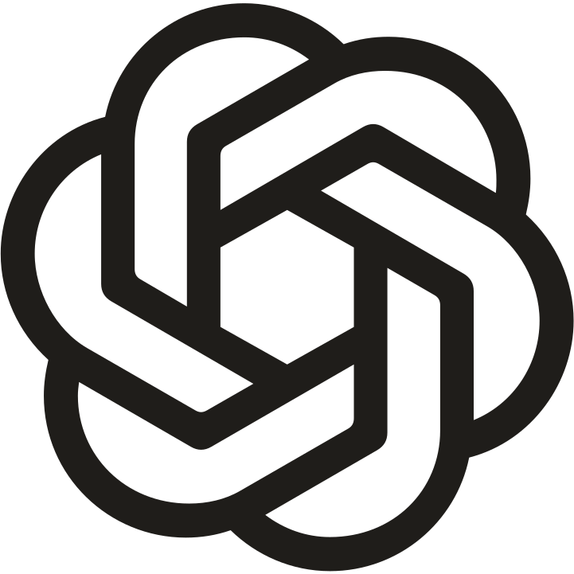

  <picture>
    <source media="(prefers-color-scheme: light)" srcset="https://raw.githubusercontent.com/Wesley-dev-tech/Wesley-dev-tech/7945647d2a23c355c1a8034f2b0df15338df3e14/assets/header-light.svg">
    
  </picture>

  <picture>
    <source media="(prefers-color-scheme: light)" srcset="https://raw.githubusercontent.com/Wesley-dev-tech/Wesley-dev-tech/2d8a95f83dce895f279ff9cd7054921b240907d6/assets/divider-light.svg">
    
  </picture>

 <strong><em>Learning without thought is labour lost; thought without learning is perilous.</em></strong> <em>Learn by building. Test what works. Improve what doesn’t.</em>

  <picture>
    <source media="(prefers-color-scheme: light)" srcset="https://raw.githubusercontent.com/Wesley-dev-tech/Wesley-dev-tech/2d8a95f83dce895f279ff9cd7054921b240907d6/assets/divider-light.svg">
    
  </picture>

###  Hi there, I'm Wesley.

🎓 I'm following the full-time **Full Stack & AI Automation Developer** course at SyntraPXL. After several years in accounting and administration, I swapped spreadsheets for stylesheets — and kept my appreciation for clean data. Now I'm learning to build websites, web applications and software tailored to real needs.

🧩 Curiosity took me from clicking buttons to wondering what happens behind them. I enjoy breaking problems into smaller steps, testing ideas and debugging the parts that have other plans. My finance background taught me to think carefully about data and processes; now I'm putting that mindset to work in code, one commit at a time.

📍 Balen, Belgium 🇧🇪

  <picture>
    <source media="(prefers-color-scheme: light)" srcset="https://raw.githubusercontent.com/Wesley-dev-tech/Wesley-dev-tech/2d8a95f83dce895f279ff9cd7054921b240907d6/assets/divider-light.svg">
    
  </picture>

## ⚙️ What I'm focused on

- 🌐 **Websites & web design** — building clear, responsive pages with HTML and CSS. “It works on my screen” isn't the finish line.

##

- 🗃️ **Web applications & data** — learning JavaScript and APIs, while giving MySQL tables, queries and relationships the structure they deserve.

##

- 🤖 **AI automation** — exploring practical ways to connect tools and reduce repetitive work. Fewer copy-paste marathons, more time to solve the actual problem.

  <picture>
    <source media="(prefers-color-scheme: light)" srcset="https://raw.githubusercontent.com/Wesley-dev-tech/Wesley-dev-tech/2d8a95f83dce895f279ff9cd7054921b240907d6/assets/divider-light.svg">
    
  </picture>

## 💻 My Tech Stack

### Frontend

<table>
  <tr>
    <td align="center" width="33%"> <strong>HTML</strong></td>
    <td align="center" width="33%"> <strong>CSS</strong></td>
    <td align="center" width="33%"> <strong>JavaScript</strong></td>
  </tr>
  <tr>
    <td align="center" width="33%"> <strong>TypeScript</strong></td>
    <td align="center" width="33%"> <strong>React</strong></td>
    <td align="center" width="33%"> <strong>Angular</strong></td>
  </tr>
  <tr>
    <td align="center" width="33%"> <strong>Vite</strong></td>
    <td align="center" width="33%"> <strong>Bootstrap</strong></td>
    <td align="center" width="33%"> <strong>Tailwind</strong></td>
  </tr>
  <tr>
    <td align="center" width="33%"><picture><source media="(prefers-color-scheme: dark)" srcset="./assets/skills/nextdotjs-dark.svg"></picture> <strong>Next.js</strong></td>
    <td align="center" width="33%"><picture><source media="(prefers-color-scheme: dark)" srcset="./assets/skills/vercel-dark.svg"></picture> <strong>Vercel</strong></td>
    <td align="center" width="33%"> <strong>Netlify</strong></td>
  </tr>
  <tr>
    <td align="center" colspan="3"><picture><source media="(prefers-color-scheme: dark)" srcset="./assets/skills/apachecordova-dark.svg"></picture> <strong>Apache Cordova</strong></td>
  </tr>
</table>

### Backend

<table>
  <tr>
    <td align="center" width="33%"> <strong>Node.js</strong></td>
    <td align="center" width="33%"><picture><source media="(prefers-color-scheme: dark)" srcset="./assets/skills/express-dark.svg"></picture> <strong>Express.js</strong></td>
    <td align="center" width="33%"> <strong>PHP</strong></td>
  </tr>
  <tr>
    <td align="center" width="33%"> <strong>Laravel</strong></td>
    <td align="center" width="33%"> <strong>Hono.js</strong></td>
    <td align="center" width="33%"><picture><source media="(prefers-color-scheme: dark)" srcset="./assets/skills/fastify-dark.svg"></picture> <strong>Fastify.js</strong></td>
  </tr>
  <tr>
    <td align="center" width="33%"> <strong>Python</strong></td>
    <td align="center" width="33%"> <strong>MySQL</strong></td>
    <td align="center" width="33%"> <strong>Supabase</strong></td>
  </tr>
</table>

### Tools & Development

<table>
  <tr>
    <td align="center" width="33%"> <picture><source media="(prefers-color-scheme: dark)" srcset="./assets/skills/github-dark.svg"></picture> <strong>Git &amp; GitHub</strong></td>
    <td align="center" width="33%"> <strong>GitHub Actions (CI/CD)</strong></td>
    <td align="center" width="33%"> <strong>Jira</strong></td>
  </tr>
  <tr>
    <td align="center" width="33%"> <strong>Trello</strong></td>
    <td align="center" width="33%"><strong>Monday</strong></td>
    <td align="center" width="33%"> <strong>ClickUp</strong></td>
  </tr>
  <tr>
    <td align="center" width="33%"><picture><source media="(prefers-color-scheme: dark)" srcset="./assets/skills/notion-dark.svg"></picture> <strong>Notion</strong></td>
    <td align="center" width="33%"><picture><source media="(prefers-color-scheme: dark)" srcset="./assets/skills/githubcopilot-dark.svg"></picture> <strong>GitHub Copilot</strong></td>
    <td align="center" width="33%"><picture><source media="(prefers-color-scheme: dark)" srcset="./assets/skills/cursor-dark.svg"></picture> <strong>Cursor</strong></td>
  </tr>
  <tr>
    <td align="center" width="33%"><picture><source media="(prefers-color-scheme: dark)" srcset="./assets/skills/openai-dark.svg"></picture> <strong>OpenAI API (ChatGPT &amp; Whisper)</strong></td>
    <td align="center" width="33%"> <strong>Vitest</strong></td>
    <td align="center" width="33%"> <strong>Jest</strong></td>
  </tr>
  <tr>
    <td align="center" colspan="3"> <strong>Insomnia</strong></td>
  </tr>
</table>

### Concepts & Methodologies

<picture><source media="(prefers-color-scheme: dark)" srcset="./assets/skills/fa-people-group-dark.svg"></picture> <strong>Scrum</strong> — an Agile framework for planning work in sprints, reviewing progress and improving as a team.

<picture><source media="(prefers-color-scheme: dark)" srcset="./assets/skills/fa-plug-dark.svg"></picture> <strong>REST API</strong> — a structured way for applications to exchange data through HTTP requests and resources.

<picture><source media="(prefers-color-scheme: dark)" srcset="./assets/skills/fa-cubes-dark.svg"></picture> <strong>Model Context Protocol (MCP)</strong> — a standard for connecting AI applications to external tools and data sources.

  <picture>
    <source media="(prefers-color-scheme: light)" srcset="https://raw.githubusercontent.com/Wesley-dev-tech/Wesley-dev-tech/2d8a95f83dce895f279ff9cd7054921b240907d6/assets/divider-light.svg">
    
  </picture>

## 📬 Let's connect

I'm looking for opportunities to keep learning alongside experienced developers and to build software that solves real problems.

  
  

