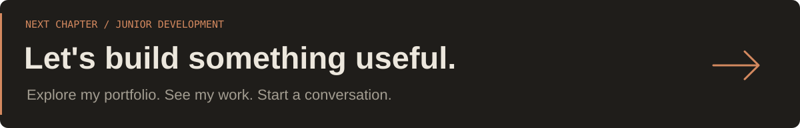

<!-- WESLEY DEV & TECH · GitHub Profile -->
<p align="center">
  <picture>
    <source media="(prefers-color-scheme: light)" srcset="./assets/header-light.svg">
    
  </picture>
</p>

<p align="center">
  <a href="https://wesley-dev-tech.github.io/Portfolio/"></a>
  <a href="https://github.com/Wesley-dev-tech?tab=repositories"></a>
</p>

### Aangenaam, ik ben Wesley 👋

Ik ben een **Full Stack & AI Automation Developer in opleiding** bij **SyntraPXL**. Na een carrière in administratie en finance maakte ik bewust de overstap naar IT. Mijn analytische achtergrond neem ik mee in wat ik nu het liefst doe: digitale oplossingen bouwen, data structureren en repetitieve processen slimmer maken met AI-automatisering.

Ik leer graag door te bouwen. Van responsieve websites en JavaScript-toepassingen tot MySQL-databanken en praktische automatisering: stap voor stap maak ik de sprong van idee naar werkend project.

<p align="center">
  <picture>
    <source media="(prefers-color-scheme: light)" srcset="./assets/divider-light.svg">
    
  </picture>
</p>

### 01 / Waar ik aan werk

| Focus | Wat ik ermee doe |
| :-- | :-- |
| **Websites & webdesign** | Responsieve interfaces met aandacht voor structuur, toegankelijkheid en gebruiksgemak. |
| **Webapplicaties** | Interactie en logica bouwen met JavaScript en TypeScript in opleiding. |
| **Software op maat** | Praktische oplossingen uitwerken vanuit een concreet probleem. |
| **AI-automatisering** | AI inzetten om terugkerende taken en workflows efficiënter te maken. |
| **Databanken** | Gegevens modelleren, normaliseren en bevragen met MySQL en SQL. |

### 02 / Mijn developer toolbox

**Frontend & development**

<p>
  
</p>

**Databases, workflow & tools**

<p>
  
</p>

`Responsive Design` · `Flexbox` · `CSS Grid` · `SQL & JOINs` · `Database normalization (1NF–3NF)` · `REST API fundamentals` · `Scrum` · `GitHub Pages` · `AI Automation`

<sub>Mijn stack groeit mee met mijn opleiding. Niet elke technologie hierboven heeft al hetzelfde ervaringsniveau.</sub>

### 03 / Van de les naar de praktijk

| Project | Wat je erin terugvindt |
| :-- | :-- |
| **[Developer Portfolio](https://wesley-dev-tech.github.io/Portfolio/)** | Mijn persoonlijke website met licht/donker thema, responsieve layouts en interactieve projectkaarten. |
| **Vloermeesters Calculator** | Prijsberekening voor vloerwerken, met offerte die je als PDF kunt downloaden. |
| **Geanimeerde Browser Mock-up** | Een browserpreview met CSS-animaties en beweging. |
| **Griezelnacht** | Een webproject uit mijn opleiding met responsive design en Bootstrap. |

> **Meer projecten ontdekken?** Bekijk mijn [GitHub repositories](https://github.com/Wesley-dev-tech?tab=repositories) of bezoek mijn [portfolio](https://wesley-dev-tech.github.io/Portfolio/) voor screenshots en live demo's.

### 04 / Mijn traject

```text
FINANCE & ADMINISTRATION
          |
          v
   ANALYTISCH DENKEN
          |
          v
FULL STACK & AI AUTOMATION
          |
          +--> Websites & webapplicaties
          +--> Databanken & SQL
          +--> AI-gestuurde automatisering
          |
          v
      BLIJVEN BOUWEN
```

### 05 / Connect & create

Een projectidee, een interessante samenwerking of gewoon zin om over development te praten?

**[Ontdek mijn werk en neem contact op via mijn portfolio](https://wesley-dev-tech.github.io/Portfolio/)**

<p align="center">
  <picture>
    <source media="(prefers-color-scheme: light)" srcset="./assets/footer-light.svg">
    
  </picture>
</p>
